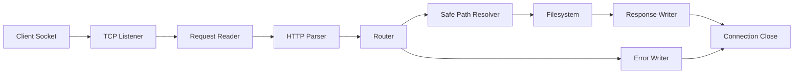

# TCP HTTP Server

A production-hardened educational HTTP/1.1 static file server implemented directly with Python sockets.

The project keeps low-level networking visible for learning, while adding practical safeguards and clean structure so it can be developed and tested like a real software artifact.

## Contents

- [Overview](#overview)
- [Key Features](#key-features)
- [Repository Layout](#repository-layout)
- [Architecture](#architecture)
- [Execution Flow](#execution-flow)
- [Installation](#installation)
- [Configuration](#configuration)
- [Usage](#usage)
- [Testing and Validation](#testing-and-validation)
- [Security and Reliability Notes](#security-and-reliability-notes)
- [Implementation Details](#implementation-details)
- [Troubleshooting](#troubleshooting)
- [Legacy Materials](#legacy-materials)

## Overview

This repository provides:

- A socket-based HTTP server for static-file responses.
- A socket-based HTTP client for integration and protocol-level testing.
- Compatibility wrappers and legacy coursework artifacts.
- A test suite that validates behavior over real TCP sockets.

## Key Features

| Area | Capability |
| --- | --- |
| HTTP support | `GET` and `HEAD` on HTTP/1.0 and HTTP/1.1 |
| Responses | `200`, `400`, `403`, `404`, `405`, `410`, `414`, `431`, `500` |
| Method handling | Explicit `405 Method Not Allowed` with `Allow` header |
| Path safety | URL decoding, traversal prevention, null-byte rejection |
| Request limits | Header size cap (`16 KiB`) and path length cap (`2048` chars) |
| Root handling | `/` resolves to `index.html` when available |
| Concurrency | Single-threaded or thread-per-connection mode |
| Shutdown route | `/BreakOut` returns `410 Gone` and stops the server |
| Client robustness | Input validation for host/port/method/path and strict response parsing |

## Repository Layout

```text
.
├── legacy_tcp_http_materials/
│   ├── HelloWorld.html
│   ├── client.py
│   ├── part_1.py
│   ├── part_2.py
│   ├── Description.pdf
│   └── Presentation.pptx
├── src/
│   └── tcp_http/
│       ├── __init__.py
│       ├── __main__.py
│       ├── client.py
│       └── server.py
├── tests/
│   ├── test_client.py
│   └── test_server.py
├── pyproject.toml
├── TCP_HTTP.zip
└── README.md
```

## Architecture



### Component Map

| Component | File | Responsibility |
| --- | --- | --- |
| `ServerConfig` | `src/tcp_http/server.py` | Immutable runtime configuration with validation |
| `HttpServer` | `src/tcp_http/server.py` | Socket lifecycle, accept loop, request routing, shutdown |
| `HttpRequest` | `src/tcp_http/server.py` | Parsed request-line and headers representation |
| `fetch` | `src/tcp_http/client.py` | Build request, execute socket exchange, parse response |
| `HttpResponse` | `src/tcp_http/client.py` | Structured response object with decoded `text` helper |

## Execution Flow

1. `HttpServer` binds host/port and enters accept loop.
2. Each connection is dispatched in current thread or a worker thread.
3. Request headers are read up to a strict limit.
4. Request-line and headers are validated and normalized.
5. Router handles method checks and shutdown path.
6. Target path is decoded, validated, and constrained to document root.
7. If file exists, headers and optional body are returned.
8. On errors, structured HTTP responses are generated with consistent metadata.

## Installation

### Requirements

| Dependency | Version |
| --- | --- |
| Python | 3.9+ |
| Runtime packages | Standard library only |

### Setup

```bash
python3 -m venv .venv
source .venv/bin/activate
python -m pip install --upgrade pip
python -m pip install -e .
```

This exposes the CLI commands:

```bash
tcp-http-server
tcp-http-client
```

You can also run directly without installation:

```bash
PYTHONPATH=src python -m tcp_http --help
```

## Configuration

### Server CLI

```bash
tcp-http-server --host 127.0.0.1 --port 6789 --root legacy_tcp_http_materials --mode threaded
```

| Option | Default | Description |
| --- | --- | --- |
| `--host` | `127.0.0.1` | Bind address |
| `--port` | `6789` | Bind TCP port (`0` is useful for tests) |
| `--root` | `.` | Document root directory to serve |
| `--mode` | `threaded` | `threaded` or `single` connection handling |

### Programmatic Config

`ServerConfig` fields:

| Field | Default | Meaning |
| --- | --- | --- |
| `host` | `127.0.0.1` | Bind host |
| `port` | `6789` | Bind port |
| `root` | `Path('.')` | Document root |
| `threaded` | `True` | Use thread-per-connection mode |
| `shutdown_path` | `/BreakOut` | Shutdown trigger path |
| `backlog` | `50` | Listen queue depth |
| `timeout` | `5.0` | Per-connection socket timeout |

## Usage

### Start server (threaded)

```bash
tcp-http-server --host 127.0.0.1 --port 6789 --root legacy_tcp_http_materials
```

### Start server (single-threaded)

```bash
tcp-http-server --host 127.0.0.1 --port 6789 --root legacy_tcp_http_materials --mode single
```

### Compatibility wrappers

```bash
python legacy_tcp_http_materials/part_1.py
python legacy_tcp_http_materials/part_2.py
python legacy_tcp_http_materials/client.py 127.0.0.1 6789 HelloWorld.html
```

### Client usage

```bash
tcp-http-client 127.0.0.1 6789 HelloWorld.html
```

### Manual HTTP checks

```bash
curl -i http://127.0.0.1:6789/HelloWorld.html
curl -I http://127.0.0.1:6789/HelloWorld.html
curl -i http://127.0.0.1:6789/BreakOut
```

## Testing and Validation

### Run tests

```bash
PYTHONPATH=src python -m unittest discover -s tests -v
```

### Compile-time validation

```bash
PYTHONPATH=src python -m compileall src tests legacy_tcp_http_materials
```

### What the suite covers

| Coverage Area | Examples |
| --- | --- |
| Happy path | `GET` file, `HEAD` file |
| Routing and status codes | Missing file, unsupported method, malformed request |
| Security behaviors | Plain and encoded traversal rejection |
| Protocol correctness | HTTP/1.1 Host requirement |
| Limits | URI length returns `414` |
| Lifecycle | Idle accept handling and shutdown endpoint |
| Client validation | Invalid method token/path/port checks |

## Security and Reliability Notes

This remains an educational server and is not a replacement for hardened production web servers, but includes practical controls:

| Concern | Current Mitigation |
| --- | --- |
| Directory traversal | Canonicalized path must remain under document root |
| Encoded traversal | URL-decoding is validated before file lookup |
| Header abuse | Header read cap with `431` response |
| Oversized target | Path length cap with `414` response |
| Null-byte path attempts | Explicit rejection with `400` |
| Improper methods | `405` plus explicit `Allow` header |
| HTTP/1.1 compliance | Missing `Host` header rejected |
| Server resilience | Controlled exception handling and clean connection closure |

For internet-facing workloads, run behind a mature reverse proxy/server stack (for example nginx, Caddy, Apache, or framework-specific ASGI/WSGI infrastructure).

## Implementation Details

### Server (`src/tcp_http/server.py`)

- Uses a small immutable config object with validation in `__post_init__`.
- Uses safe path resolution based on `Path.resolve()` and `relative_to()`.
- Distinguishes client errors from internal errors via explicit status mapping.
- Avoids message-body responses for `HEAD` error paths by setting `Content-Length: 0`.
- Supports root index serving (`/` -> `index.html`) while keeping directory listing disabled.

### Client (`src/tcp_http/client.py`)

- Sends standards-compliant HTTP/1.1 requests.
- Validates method token shape and path newline safety to avoid request injection.
- Parses status line and headers into structured response data.
- Raises explicit exceptions for invalid server responses and timeout while reading.

## Troubleshooting

| Symptom | Likely Cause | Resolution |
| --- | --- | --- |
| `Address already in use` | Port collision | Choose a different `--port` or stop existing process |
| `404 Not Found` | File missing under document root | Verify `--root` and request path |
| `403 Forbidden` | Directory request without index or traversal attempt | Request a valid file path within root |
| `400 Bad Request` | Malformed request or missing Host header (HTTP/1.1) | Send valid request line/headers |
| Import errors in tests | Missing package path | Use `PYTHONPATH=src` when running tests |

## Legacy Materials

Legacy coursework artifacts are retained in `legacy_tcp_http_materials` and `TCP_HTTP.zip` for historical context.

They are not required for normal package usage, but remain available for continuity and comparison.
